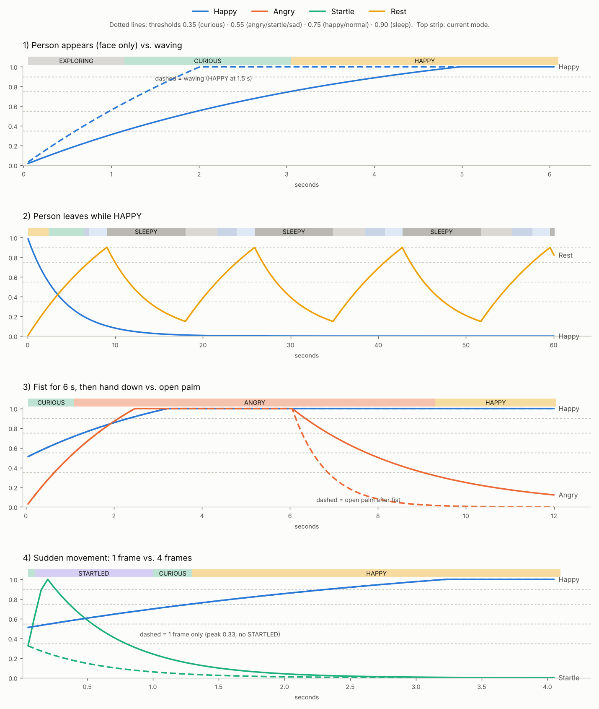

# ฮอร์โมน อารมณ์ และท่าทาง

เอกสารนี้อธิบายว่าในโค้ด `pc/auto_bio_lamp.py` ฮอร์โมนแต่ละตัวเพิ่มขึ้น-ลดลงอย่างไร เปลี่ยนเป็นอารมณ์ไหน และแต่ละอารมณ์ทำท่าทางอะไร

เวลาทั้งหมดในเอกสารนี้ได้จากการจำลองโค้ดจริงที่ 20 รอบ/วินาที (`dt = 0.05`) บนหุ่นจริงอาจคลาดเคลื่อนได้นิดหน่อยตามความเร็วของคอม

---

## 1. สมการฮอร์โมน (`class ArtificialHormone`)

ทุกรอบ (ทุก 0.05 วินาที) ฮอร์โมนแต่ละตัวคำนวณแบบนี้:

```
P = k_prod  × max(S, 0)          # ผลิต: มีสิ่งเร้า (S > 0) ถึงจะเพิ่ม
C = k_clear × H                  # สลายตามธรรมชาติ (ยิ่งมากยิ่งสลายเร็ว)
    ถ้า S < 0 → k_clear × fast_clear_mult   (สิ่งเร้าทางลบ = สลายเร็วขึ้นหลายเท่า)
B = k_bind  × R                  # ถูกใช้ไปโดยตัวรับ
H = H + dt × (P − C − B)         # จำกัดไว้ 0 … 1
R = H                            # ค่าที่ใช้จริง (r_gain = 1)
```

สรุปง่าย ๆ:
- **S > 0:** ฮอร์โมนเพิ่มขึ้น ยิ่ง `k_prod` สูงยิ่งขึ้นเร็ว
- **S = 0:** ค่อย ๆ ลดลงเอง ด้วยอัตรา `k_clear + k_bind`
- **S < 0:** ลดลงเร็วขึ้น `fast_clear_mult` เท่า

## 2. ฮอร์โมน 4 ตัว

| ฮอร์โมน (บนกราฟ) | ตัวแปร | k_prod | k_clear | k_bind | fast_clear | หน้าที่ |
|---|---|---|---|---|---|---|
| **Happy** (ความสนใจ/ดีใจ) | `h_attentive` | 0.35 | 0.20 | 0.05 | – | มีคนอยู่ด้วย → สนใจ → ดีใจ |
| **Angry** (โกรธ) | `h_anger` | 0.60 | 0.30 | 0.05 | ×4 | โดนกำปั้นใส่ |
| **Startle** (ตกใจ) | `h_startle` | 6.5 | 1.5 | 0.2 | – | ขึ้นเร็วมาก หายเร็วมาก |
| **Sad/Slp** (เหงา/ง่วง) | `h_rest` | 0.14 | 0.08 | 0 | ×2.5 | ไม่มีใครอยู่ → เหงา → หลับ |

### อะไรทำให้ฮอร์โมนขึ้น-ลง (สิ่งเร้า S)

| สิ่งที่เห็น | Happy (S_face) | Angry (S_anger) | Startle (S_spike) | Sad/Slp |
|---|---|---|---|---|
| ไม่มีใครเลย | 0 → ลดลงเอง | 0 → ลดลงเอง | 0 | **+1 → เพิ่ม** |
| เห็นหน้า | **1.0** | 0 | – | −1 → ลดเร็ว |
| เห็นมือ (ท่าอะไรก็ได้) | **1.0** | 0 | – | −1 → ลดเร็ว |
| แบมือ ✋ | **1.4** | **−1 → สลายเร็ว ×4** | – | −1 |
| โบกมือ 👋 | **1.8** | −1 → สลายเร็ว | ไม่ตกใจ | −1 |
| กำปั้น ✊ | 1.0 | **+1** (ถ้าไม่ได้ตกใจอยู่) | – | −1 |
| หน้าพุ่งเข้ามา / ขยับเร็ว (หน้าใหญ่ขึ้น > 0.035 หรือขยับ > 12% ของจอใน 1 เฟรม) | – | – | **+1** | – |
| มือพุ่งเข้ามา / ขยับเร็ว / โผล่มาใกล้ทันที | – | – | **+1** (ยกเว้นตอนโบกมือ) | – |
| ท่าชู่ว์ 🤫 | – | −1 → สลายเร็ว | **0 (ไม่ตกใจ)** | – |
| ตอนกำลังหลับ (SLEEPY) | – | – | – | **−1 → ลดลงเอง** |

> ⚠️ ข้อสังเกต: ตอนหลับ ฮอร์โมน Sad/Slp จะลดลงเองแม้ไม่มีใครมา หุ่นเลย **หลับประมาณ 9 วินาทีแล้วตื่นขึ้นมาสำรวจเอง** วนแบบนี้ไปเรื่อย ๆ (ดูข้อ 4 กราฟที่ 2)

## 3. เกณฑ์เปลี่ยนอารมณ์ (State Machine)

เช็กตามลำดับจากบนลงล่าง ข้อไหนผ่านก่อนได้ข้อนั้น แต่ละอารมณ์มี "เกณฑ์เข้า" กับ "เกณฑ์ออก" ต่างกัน (hysteresis) เพื่อไม่ให้สลับอารมณ์ไปมาถี่ ๆ

| ลำดับ | อารมณ์ | เข้าเมื่อ | อยู่ต่อจนกว่า |
|---|---|---|---|
| 0 | **QUIET** (ชู่ว์) | เห็นท่าชู่ว์ต่อเนื่อง 6 เฟรม (~0.3 วิ) | ครบ 6.4 วิ |
| 0 | **SULK** (งอน) | หลอดงอน = 1.0 | หลอดงอน ≤ 0.30 |
| 1 | **STARTLED** | Startle ≥ 0.55 | Startle < 0.25 |
| 2 | **ANGRY** | Angry ≥ 0.55 | Angry < 0.32 |
| 3 | **HAPPY** | Happy ≥ 0.75 | Happy < 0.55 |
| 4 | **CURIOUS** | Happy ≥ 0.35 | Happy < 0.20 |
| 5 | **SLEEPY** | Sad/Slp ≥ 0.90 | Sad/Slp ≤ 0.15 |
| 6 | **NORMAL** | Sad/Slp ≥ 0.75 | – |
| 7 | **SAD** | Sad/Slp ≥ 0.55 | – |
| 8 | **EXPLORING** | ไม่เข้าข้อไหนเลย | – |

QUIET กับ SULK ไม่ได้อยู่ใน state machine ปกติ แต่ **ทับท่าทางของอารมณ์อื่น** ฮอร์โมนข้างใต้ยังทำงานต่อตามปกติ

## 4. ใช้เวลานานแค่ไหน (จากการจำลอง)



| สถานการณ์ | ผลลัพธ์ |
|---|---|
| มีคนมายืนเฉย ๆ | CURIOUS ที่ 1.2 วิ → HAPPY ที่ 3.1 วิ |
| แบมือ | CURIOUS ที่ 0.8 วิ → HAPPY ที่ 2.0 วิ |
| โบกมือ | CURIOUS ที่ 0.6 วิ → HAPPY ที่ 1.5 วิ |
| คนเดินออกไปตอน HAPPY | CURIOUS ที่ 2.4 วิ → SAD ที่ 6.4 วิ → NORMAL ที่ 7.0 วิ → SLEEPY ที่ 9.1 วิ |
| หลับไปแล้ว | หลับ ~9 วิ → EXPLORING ~3.6 วิ → SAD ~2.3 วิ → NORMAL ~2 วิ → หลับใหม่ (วนทุก ~17 วิ) |
| กำปั้น | ANGRY ใน ~1.1 วิ |
| เลิกกำปั้น (ปล่อยมือลงเฉย ๆ) | หายโกรธหลังเอามือลง ~3.3 วิ |
| เลิกกำปั้นแล้วแบมือ | หายโกรธใน ~1 วิ |
| ขยับเร็ว 1 เฟรม | Startle ขึ้นแค่ 0.33 **ยังไม่ตกใจ** |
| ขยับเร็ว 2 เฟรมขึ้นไป | STARTLED ทันที อยู่ ~0.9 วิ |
| กำปั้นค้าง (สะสม) | หลอดงอนเต็มใน ~6.4 วิ |
| งอนแล้วโบกมือง้อ | หายงอนใน ~2.5 วิ |
| งอนแล้วปล่อยไว้ | หายงอนเองใน ~20 วิ |

## 5. หลอดเสริม

### ระดับการโบกมือ (`wave_level`, 0 … 1)
- **นับเป็นโบกมือเมื่อ:** แบมือแล้วส่ายซ้าย-ขวาเปลี่ยนทิศ ≥ 2 ครั้ง ภายใน 1.5 วิ และส่ายกว้าง ≥ 8% ของจอ
- **ระหว่างโบก:** +0.15 ต่อเฟรม (เต็มใน ~0.35 วิ)
- **หยุดโบก:** −0.03 ต่อเฟรม (หายใน ~1.7 วิ)

### หลอด Mood (−1 … +1) → คุมความเร็ว
```
mood_target = (Happy + 0.5 × wave_level) − (Sad/Slp + 0.6 × Startle)
mood ค่อย ๆ ไล่ตาม mood_target ด้วยอัตรา MOOD_RATE = 0.4  (ใช้เวลาประมาณ 2.5 วิ)
speed_mult = 1 + 0.5 × mood        (mood = +1 → ×1.5, mood = −1 → ×0.5)
```
`speed_mult` คูณความเร็วมอเตอร์ และหารเวลาไล่ตามเป้า ใช้กับทุกท่า **ยกเว้นท่าชู่ว์**

### หลอดงอน (Sulk, 0 … 1)

| เหตุการณ์ | เปลี่ยนต่อวินาที |
|---|---|
| โกรธ | + 0.20 × Angry |
| โบกมือ (wave_level > 0.3) | − 0.25 × wave_level |
| ปกติ (ยังไม่งอน) | − 0.01 |
| กำลังงอน (หายเอง) | − 0.035 |

- **หลอดเต็ม 1.0:** เริ่มงอน
- **ลดลงถึง 0.30:** หายงอน

### จังหวะการแกว่งตัว (CPG)
ทุกท่ามีการแกว่งเล็ก ๆ ให้ดูมีชีวิต สัญญาณ `o1`, `o2` แกว่งระหว่าง **±0.57** และคูณด้วย `SWAY_SCALE`

```
phi = 0.20 + 0.20×Happy + 0.25×Angry − 0.10×Sad/Slp + 0.12×wave_level + 0.06×mood   (จำกัด 0.10 … 0.50)
```

| phi | ความเร็วการแกว่ง | เกิดตอนไหน |
|---|---|---|
| 0.1 – 0.2 | ช้า (1 รอบ 1.6 – 3 วิ) | อยู่คนเดียว |
| 0.3 | ปานกลาง (1 รอบ ~1.1 วิ) | – |
| 0.4 – 0.5 | ถี่ (1 รอบ 0.6 – 0.8 วิ) | ดีใจ / โกรธ / โบกมือ |

## 6. ท่าทางทุกท่า

มุมเรียงเป็น **[ฐาน q1, ไหล่ q2, ศอก q3, ข้อมือ q4]** หน่วยองศา

ลิมิตของแต่ละข้อต่อ:

| ข้อต่อ | ลิมิต |
|---|---|
| ฐาน | −79 … 79 |
| ไหล่ | 0 … 127 |
| ศอก | −117 … 0 |
| ข้อมือ | −45 … 43 |

ในตารางด้านล่าง:
- `หันหาคน` = `(0.5 − ตำแหน่งคนแนวนอน) × ตัวคูณ`
- `ตามความสูงคน` = มุมก้ม-เงยตามตำแหน่งคนแนวตั้ง
- ค่า "แกว่ง" คิดจาก CPG ±0.57 แล้ว
- เวลาไล่ตาม = ยิ่งน้อยยิ่งไว ความเร็วทั้งสองค่าถูกคูณด้วย `speed_mult` อีกที

### ท่าตอนมีคนอยู่

| อารมณ์ | ฐาน | ไหล่ | ศอก | ข้อมือ | เวลาไล่ตาม / ความเร็วมอเตอร์ | ไฟ (RGB) | ลักษณะ |
|---|---|---|---|---|---|---|---|
| **CURIOUS** | หันหาคน (×110) | IK | IK | ตามความสูงคน (×40) | 0.25 วิ / 25% | เขียว (0,220,60) | ใช้ IK ยื่นหัวไปข้างหน้า 135 มม. สูง ~230 มม. ขยับสูง-ต่ำตามหน้าคน (ตรงกลาง ≈ [0, 86, −85, −1]) ถ้า IK หาท่าไม่ได้ใช้ [หันหาคน, 80, −75, ตามความสูง] |
| **HAPPY** | หันหาคน (×110) ± 4.6° | 75 ± 3.4° | −40 | −20 + ตามความสูงคน (×35) ± 6.8° | 0.20 วิ / 30% | เหลืองส้ม (255,190,0) | ยืดตัวสูง ส่ายตัว ผงกหัวตามจังหวะ |
| ↳ **HAPPY + โบกมือ** | หันหาคน ± **20°** | 75 ± **9°** | −40 | … ± **12.5°** | **0.14 วิ / 50%** | เหลืองส้ม | ส่ายกว้าง ผงกแรง เร็วขึ้น |
| **STARTLED** | หันหาคน (×95, จำกัด ±70) | IK | IK | −22 | 0.14 วิ / **60%** | ม่วง (180,0,255) | ใช้ IK ดึงหัวขึ้นสูง 245 มม. ชิดฐาน 85 มม. หงายหัว (ตรงกลาง ≈ [0, 118, −87, −45]) ถ้า IK หาท่าไม่ได้ใช้ [หันหาคน, 115, −112, −22] |
| **ANGRY** | หันหาคน (×90) ± **16°** | 62 ± 6.8° | −55 ∓ 6.8° | −5 ± 12.5° | **0.12 วิ** / 55% | แดง (255,0,0) | ส่ายหัวแรง ๆ โน้มตัวเข้า-ออกเหมือนขู่ |
| **SULK** (งอน) | หันหนี +75° จากคน (ตอนใกล้หาย แอบหันกลับมา 40%) ± 1° | 88 | −85 | 22 ± 1.7° | 0.40 วิ / 15% | ม่วงแดงหรี่ (90,0,60) | หันหน้าหนี ก้มหน้า แทบไม่ขยับ |

### ท่าตอนอยู่คนเดียว

| อารมณ์ | ฐาน | ไหล่ | ศอก | ข้อมือ | เวลาไล่ตาม / ความเร็ว | ไฟ (RGB) | ลักษณะ |
|---|---|---|---|---|---|---|---|
| **EXPLORING** | ± **26°** | 70 | −60 | −30 ± 5.7° | 0.25 วิ / 25% | ขาว (220,220,220) | หมุนกวาดซ้าย-ขวากว้าง ๆ เงยหัวมองหาคน |
| **SAD** | ± 6.8° | 95 ± 1.7° | −95 | 32 ± 2.3° | 0.30 วิ / 20% | น้ำเงินเข้ม (5,10,100) | ก้มหัวคอตก ส่ายช้า ๆ |
| **NORMAL** | ± 2.9° | 80 | −75 | −10 ± 1.1° | 0.30 วิ / 20% | ฟ้า (60,200,255) | ยืนตรงนิ่ง ๆ |
| **SLEEPY** | 0 | 102 ± 0.9° | −102 | 36 ± 1.1° | 0.35 วิ / 15% | ดับ (0,0,0) | ขดตัวก้มหัวต่ำสุด ขยับเบา ๆ เหมือนหายใจ |

### ท่าชู่ว์ (QUIET) — ไม่ขึ้นกับ mood

| ช่วง | เวลา | ฐาน | ไหล่ | ศอก | ข้อมือ | ความเร็ว |
|---|---|---|---|---|---|---|
| 1. ถอยหลัง | 0.8 วิ | หันหาคนที่สั่ง (จำกัด ±70) | 100 | −20 | −15 | 30% |
| 2. พยักหน้า ×2 | 1.6 วิ | เดิม | 100 → 96 | −20 | −15 → **+10** (ก้มลง 25°) | 40% |
| 3. เงียบ | 4.0 วิ | เดิม | 97 | −20 | 8 | 10% |

ไฟเป็นน้ำเงินหรี่ (20,20,70) ตลอดทั้งท่า ถ้าชู่ว์ซ้ำตอนเงียบอยู่ จะเริ่มนับช่วงเงียบใหม่

### ท่าตอนเปิด / ปิดโปรแกรม

| ช่วง | ท่า | เวลา | ความเร็ว | ไฟ |
|---|---|---|---|---|
| เปิด: ไปท่าพักก่อน | `SHUTDOWN_Q` = [0, 102, −102, 36] | รอ 2 วิ | 15% | ดับ |
| เปิด: ตื่น | → `STARTUP_Q` = [0, 90, −90, 0] | 1.5 วิ | 20% | ดับ → ขาว |
| ปิด: เข้านอน | → `SHUTDOWN_Q` | 2.0 วิ | 15% | สีปัจจุบัน → ดับ |

## 7. ลำดับความสำคัญของท่าทาง

ถ้าเกิดหลายอย่างพร้อมกัน ตัวซ้ายชนะ:

```
QUIET (ชู่ว์)  >  SULK (งอน)  >  STARTLED  >  ANGRY  >  HAPPY  >  CURIOUS  >  SLEEPY / NORMAL / SAD / EXPLORING
```

## 8. ระบบลดอาการสั่น (ทำงานกับทุกท่า)

- **ลูปหลัก:** แค่ตั้งเป้า แล้ว thread มอเตอร์ไล่ตามด้วยตัวกรอง 2 ชั้น จังหวะคงที่ 20 ครั้ง/วินาที
- **เวลาไล่ตาม:** "เวลาไล่ตาม" ในตารางแปลงเป็น time constant ของตัวกรอง (`duration_to_tc`) ปรับรวมได้ด้วย `SMOOTH_GAIN`
- **Deadband:** ตำแหน่งเปลี่ยนไม่ถึง `DEADBAND_COUNTS` (2 หน่วย ≈ 0.4°) ไม่ส่งคำสั่ง
- **Deadzone:** คนขยับไม่ถึง `TARGET_DEADZONE` (1.2% ของจอ) ไม่ตาม
